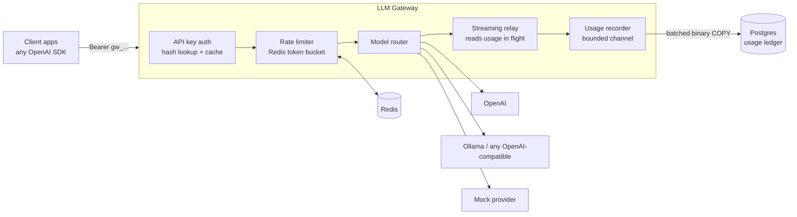

# LLM Gateway

[](https://github.com/shubhiofficial-17/llm_gateway/actions/workflows/ci.yml)

A self-hosted, OpenAI-compatible gateway that sits between your apps and LLM providers. It gives every team its own API key, streams responses with no buffering, and records the token usage and cost of every request in a Postgres ledger.

Apps switch to it by changing one setting, the base URL. Any OpenAI SDK works unchanged.

Built with .NET 8, ASP.NET Core minimal APIs and PostgreSQL.

## Why

When many teams call LLM APIs directly:

- nobody can say what each team spends until the invoice arrives
- provider API keys get copied into every service
- one provider outage takes every AI feature down
- one runaway script can burn the month's budget

A gateway fixes all four in one place.

## Status

| Milestone | Scope | Status |
|---|---|---|
| 1. Core proxy | OpenAI-compatible API, SSE streaming, per-team API keys, usage and cost ledger, mock provider, Docker Compose, CI | ✅ Done |
| 2a. Request rate limits | Per-team requests-per-minute token bucket in Redis (atomic Lua), 429 + Retry-After | ✅ Done |
| 2b. Per-team overrides | Admin endpoint to give a team its own requests-per-minute limit | ✅ Done |
| 2c. Token limits | Tokens-per-minute limit: reserve an estimate up front, refund the unused part afterwards | ✅ Done |
| 2d. Budgets | Monthly spend budgets per team (reserve then settle) | ⏳ Next |
| 3. Reliability | Anthropic adapter, provider fallback chains, circuit breakers, retries | Planned |
| 4. Semantic cache | Embedding-based response cache with a tuned similarity threshold | Planned |
| 5. Observability | OpenTelemetry traces, Grafana cost dashboard, k6 load tests, chaos demo | Planned |

## Architecture



How a request flows:

1. `ApiKeyMiddleware` hashes the bearer key, looks up the team (cached for 60s) and rejects unknown keys.
1. `RateLimitMiddleware` takes a token from the team's request bucket in Redis, or returns `429` with `Retry-After`.
1. The endpoint reserves the request's worst-case token count from the team's token bucket. Once the real count is known, the unused part is refunded.
2. The model name is resolved to a provider and the upstream model name, and the request body is rewritten.
3. For streaming requests the gateway always asks upstream for a final usage chunk, so it can bill real token counts.
4. `SseRelay` forwards each event as soon as it arrives, reads usage on the way through and drops the usage chunk if the client didn't ask for it.
5. A `UsageEvent` goes into a bounded channel. A background service writes events to Postgres in batches with binary `COPY`, off the request path.

## Quick start

Requires Docker.

```bash
git clone https://github.com/shubhiofficial-17/llm_gateway.git
cd llm_gateway
docker compose up --build
```

This starts the gateway on `http://localhost:8080` with a demo team whose key is `gw-demo-key`. The `mock-1` model needs no provider key, so you can try everything immediately.

```bash
# Non-streaming
curl http://localhost:8080/v1/chat/completions \
  -H "Authorization: Bearer gw-demo-key" -H "Content-Type: application/json" \
  -d '{"model":"mock-1","messages":[{"role":"user","content":"Hello gateway"}]}' -i

# Streaming: watch tokens arrive one by one
curl -N http://localhost:8080/v1/chat/completions \
  -H "Authorization: Bearer gw-demo-key" -H "Content-Type: application/json" \
  -d '{"model":"mock-1","stream":true,"messages":[{"role":"user","content":"Stream this please"}]}'

# This month's spend for the team
curl http://localhost:8080/admin/teams/demo/usage -H "X-Admin-Key: dev-admin-key"
```

To use real OpenAI models, start with your key set: `OPENAI_API_KEY=sk-... docker compose up --build`, then call `gpt-4o-mini`.

### From an OpenAI SDK

```python
from openai import OpenAI

client = OpenAI(base_url="http://localhost:8080/v1", api_key="gw-demo-key")
stream = client.chat.completions.create(
    model="mock-1",
    messages=[{"role": "user", "content": "hi"}],
    stream=True,
)
for chunk in stream:
    print(chunk.choices[0].delta.content or "", end="")
```

## API

| Endpoint | Auth | Description |
|---|---|---|
| `POST /v1/chat/completions` | Team key | OpenAI-compatible chat completions, streaming and non-streaming |
| `GET /v1/models` | Team key | Models this gateway serves |
| `POST /admin/teams` | Admin key | Create or rename a team: `{"id":"payments","name":"Payments"}` |
| `GET /admin/teams/{id}` | Admin key | Team details, including limit overrides |
| `PUT /admin/teams/{id}/limits` | Admin key | Override limits: `{"requestsPerMinute":300}`. `null` restores the default, `0` means unlimited |
| `POST /admin/teams/{id}/keys` | Admin key | Issue an API key. It is shown once; only its SHA-256 hash is stored |
| `GET /admin/teams/{id}/usage?from=&to=` | Admin key | Requests, tokens and cost per model. Defaults to the current month |
| `GET /healthz` | None | Liveness |

Responses include `x-request-id` and `x-gateway-provider`. Non-streaming responses also include `x-gateway-cost-micros`. Errors use OpenAI's error format, so SDKs raise their normal exceptions.

## Configuration

Providers and models are configured in `appsettings.json` or environment variables (`Gateway__Providers__openai__ApiKey`, and so on).

```jsonc
"Providers": {
  "openai": { "Type": "openai-compatible", "BaseUrl": "https://api.openai.com/v1", "ApiKey": "" },
  "ollama": { "Type": "openai-compatible", "BaseUrl": "http://localhost:11434/v1" },
  "mock":   { "Type": "mock" }
},
"Models": {
  "gpt-4o-mini": { "Provider": "openai", "InputPricePerMTok": 0.15, "OutputPricePerMTok": 0.60 }
}
```

`openai-compatible` covers any API that speaks OpenAI's format: OpenAI, Ollama, Groq, vLLM, LM Studio. Prices are USD per million tokens. Check them against your provider's pricing page.

Without a `ConnectionStrings:Postgres` value the gateway uses in-memory stores. That's handy for `dotnet run`, but nothing survives a restart.

## Design decisions

Each significant choice is recorded as an ADR in [`docs/adr`](docs/adr):

- [0001 – Speak OpenAI's API format](docs/adr/0001-openai-compatible-api.md)
- [0002 – Write usage asynchronously, store money as integer micro-dollars](docs/adr/0002-async-usage-ledger.md)
- [0003 – Store API keys as SHA-256 hashes](docs/adr/0003-api-key-hashing.md)
- [0004 – Bill streamed requests from the provider's usage chunk](docs/adr/0004-billing-streamed-requests.md)
- [0005 – Per-team rate limits with a Redis token bucket](docs/adr/0005-rate-limiting.md)
- [0006 – Tokens-per-minute limits: reserve an estimate, refund the rest](docs/adr/0006-token-rate-limits.md)

## Tests

```bash
dotnet test
```

- **Integration tests** run the whole gateway in memory with `WebApplicationFactory`. They cover auth, streaming, usage recording, error pass-through and admin flows.
- **Provider tests** run the real HTTP path against a fake upstream. They check model rewriting, `stream_options` injection, the API key header, 429 pass-through and 502 on connection failure.
- **SSE relay unit tests** cover usage extraction, dropping the usage chunk, comments, CRLF input and a missing trailing newline.
- **Redis rate limiter tests** use Testcontainers. 200 concurrent requests race for 10 tokens and exactly 10 succeed.
- **Postgres tests** use Testcontainers against a real Postgres 16 instance. They cover the schema, key lookup and batched `COPY` writes with the usage summary.

## Project layout

```
src/LlmGateway
  Auth/        API key middleware, team stores (Postgres + in-memory)
  Chat/        /v1/chat/completions endpoint, SSE relay
  Providers/   provider interface, OpenAI-compatible + mock providers, model registry
  Usage/       usage recorder (channel), background writer, stores, pricing, token estimates
  Admin/       admin endpoints and admin key filter
  Data/        schema.sql, startup schema initializer, bootstrap seeding
tests/LlmGateway.Tests
docs/adr
```

## License

MIT
